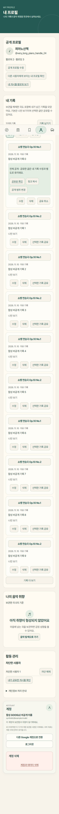

# 음악 이야기·내 프로필 통합 — 구현 결과

CA-NAV-PROFILE-IA-20261110-001 / 명세1 / **IMPLEMENTED**. 기준 main `465173d2e2e41ee58f387b18b6897a3e29cbaff9`, 기능·테스트 코드 `1a03ca832329a356fa15a615af568958244c911e`, 브랜치 `codex/ca-nav-profile-ia-20261110-001`. [사용자 명세](NAV_PROFILE_IA_SPEC.md), [검증 JSON](NAV_PROFILE_IA_VERIFICATION_2026-11-10.json), [HANDOFF](../HANDOFF.md)를 함께 읽는다. Draft PR 검토 전이며 main 병합·운영 DB·운영 배포는 하지 않았다.

## 변경 전후 정보 구조

| 영역 | 변경 전 | 변경 후 |
| --- | --- | --- |
| 음악 이야기 | MUSIC JOURNAL / 내 음악 기록; 피드·개인 원본·프로필·계정 버튼 | MUSIC STORIES / 음악 이야기; 공개 탐색·게시물 목록, 기록 작성은 내 기록으로 이동 |
| 나의 취향 | 취향 차트와 계정 | 내 프로필: 공개 프로필 → 내 기록 → 나의 음악 취향 → 활동 관리 → 계정 |
| 보관함 | 보관한 곡/내 음악 기록 전환 | 보관한 곡만 표시 |
| 곡 상세 | 나의 음악 기록 | 같은 문맥 기록 작성 기능 유지, 로그인 안내를 내 프로필로 정리 |
| 하단 메뉴 | 아이콘과 텍스트5개 | 나침반·무대·북마크·사용자·피아노 아이콘5개, 접근 가능한 이름·title·활성 aria-current |

공개 프로필 만들기/수정과 기본 아바타·닉네임/@아이디·팔로워/팔로잉 숫자를 내 프로필로 모았다. 기존 닉네임은 수정할 수 없다. Google 이름/이메일은 계정 영역에만 표시하며 공개 프로필에 자동 입력하지 않는다. 공개 헤더 미리보기는 공개 정체성만 보여주고 게시물 열람 권한을 우회하지 않는다.

내 기록은 기존 MyMusicRecords/MusicJournalRecords의 조회·곡 선택 작성·수정·삭제·추가 페이지·공유·공유 취소를 재사용한다. 공유한 글의 공개 범위 변경은 기존 social_feed(post)로 공유본 내용을 읽고 social_edit_post로 저장한다. 나만 보기 기본값·변경 전 범위 확인과 재확인, 실패 초안 보존을 유지한다. 개인 기록 수정이 공유본 내용을 자동 변경하지 않는다. 개인 기록 삭제 시 공유본 연계 삭제 정책은 기존 RPC/FK 그대로다. 표시 상태는 나만 보기/팔로워 공개/전체 공개다.

필터 전체/나만 보기/공개 중은 **이미 불러온 기록 집합**에 적용한다. 추가 기록은 기존 기록 더 보기로 불러오며 이 제한을 화면에도 설명한다. publication이 없거나 private이면 나만 보기, followers/public이면 공개 중에만 포함한다. private 공유본을 공개 중에 넣거나 “공유 중 · 나만 보기”로 표시하지 않는다. 서버 필터 API나 migration을 추가하지 않았다. 차단 목록 API는 blocked_id만 반환하므로 화면에는 “차단한 사용자 1…”처럼 구분하고 해제할 수 있다. 새 권한으로 차단된 사람의 프로필을 조회하거나 Auth UUID를 노출하지 않는다.

## 컴포넌트·요청·구독

- MusicSocial: 피드/곡별/타인 프로필/개별 게시물, 좋아요·댓글·팔로우·차단·신고·공유본 메뉴와 기존 Realtime 재연결만 담당한다. records/profile 탭·Account·MyMusicRecords·자신의 ProfileEditor·차단 관리 화면은 없다. 공개 프로필 미설정 사용자는 안내와 내 프로필 만들기 버튼을 본다.
- MyProfile: social_me/social_profile와 차단 목록을 읽고 필요한 개인 작업만 실행한다. 프로필 진입 시 전체 feed를 요청하거나 Realtime 채널을 만들지 않는다. metadata는 새 진입/포커스·표시 복귀와 본인 저장/차단 해제 후 재조회한다. 입력 중 기록은 metadata 재조회로 폐기하지 않는다.
- 명시적으로 내가 공유한 게시물 섹션을 열 때만 person=본인 공개 profile ID로 조회하고 기존 공유 invalidation subscriber를 사용한다. 채널 오류/오프라인/숨김/공유 취소 시 글을 비우고 재연결 후 권한을 다시 읽는다. 전환 과정에서 활성 채널 최대1개를 합성 검증했다. profile 기본 진입의 구독0개와 구분한다.
- SocialProfile: Avatar/ProfileEditor만 공유한다. 아바타 URL 변경 후 실패 상태도 초기화한다. 기존 Supabase client와 Google 세션을 재사용하며 새 인증 SDK/client를 생성하지 않는다.

## URL·세션

`#music`, `#music/post/{id}`, `#music/profile/{id}`, `#music/track/{id}`와 옛 `?story=`를 유지한다. 타인 프로필은 음악 이야기 안에서 열고 자신의 프로필 링크는 통합 내 프로필로 보낸다. 자신의 프로필 딥링크는 replaceState로 바꿔 브라우저 뒤로가기의 재이동 고리를 피한다. `#profile/records`는 내 기록 제목에 스크롤·focus, `#profile/posts`는 내 게시물 제목에 focus한다. 내부 taste 식별자는 유지한다.

계정 전환 버튼과 로그아웃 버튼을 분리했다. 계정 전환은 로컬 계정 사본 정리·현재 세션 폐기 → scope=local 로그아웃 **완료 대기** → 기존 signInWithOAuth(google)에 prompt=select_account를 전달한다. redirectTo/PKCE client 설정은 그대로다. 중복 전환을 잠그고 로그아웃 실패 시 OAuth를 시작하지 않는다. 이전 token refresh/초기 세션 응답, 계정 전환 후 늦은 목록 응답은 화면을 복구하지 못한다. React 보관함 상태에도 소유자 표식을 두어 로그아웃 직후 오래된 취향이 잠깐 노출되지 않게 하며, 대기 중인 이전 계정 동기화는 실행 전에 소유자를 확인한다. 비회원이 이후 새로 보관하는 동작은 계속 가능하다.

계정 삭제는 맨 아래 위험 영역과 기존 2단계 확인을 유지한다. delete_current_user_account·연계 삭제 정책은 수정하지 않았다. 개인정보 안내는 활동 관리에서 확인하며 Google 이름/이메일은 계정 영역에만 있다.

## 검증

| 검증 | 결과·환경 |
| --- | --- |
| npm test | **166/166 PASS**, fail/skip0; Windows/Node22.18.0, PGlite·JSDOM·실 JSX 컴파일 |
| npm run test:social | **5/5 PASS**, 기존 SQL/RLS·SDK REST 계약·세션·피드 무효화/재연결 회귀 |
| node scripts/testProfileIa.mjs | **4/4 PASS**, 통합 기록/프로필/세션/라우팅과 느린·실패 로그아웃·중복 요청/늦은 응답 |
| npm run build | **PASS**, 기존 500 kB chunk 경고 유지 |
| 모바일 Chromium | **36/36 PASS**, 320/375/390/520px × 피드/메뉴/내 기록/공개 프로필 안내/프로필 편집 focus/기록 textarea focus/삭제 확인/비로그인 피드/비로그인 프로필 |
| 게시 검사 | JSON·링크·diff·비밀값 제외·원래 IDE 파일52개/HEAD/문서 보존, migration/client/API 계약·곡 ID/평가/패키지 무변경 확인 |

실제 Chromium에서 Pretendard, -0.03em, 최소12px 짝수 크기, 한 줄 normal/여러 줄1.5, 아이콘28px, 터치48px, 동일 너비·중앙 정렬, aria-label/title/active page, 가로 넘침0, 기록 제목 focus/Tab 순서/뒤로가기, 하단 계정 버튼 가림 없음, 화면 오류0을 확인했다. viewport emulation이며 실제 기기 가상 키보드·IME·hardware safe-area 검증은 아니다. CSS에는 기존 safe-area 여백을 유지했다.



사진의 계정·본문은 전부 scripts/profileIaFixture.mjs의 **합성 값**이다. 모바일 브라우저는 로컬 정적 서버 외 네트워크를 차단했다. 개인정보나 실제 기록을 캡처하지 않았다. 초기 전체 실행은 자식 프로세스 sandbox 제한(spawn EPERM) 때문에 완료 결과로 취급하지 않았고, 허용 환경에서 최종165개와 build를 정상 완료했다. 모바일 하단 좌표 검사는 기존 smooth scroll이 끝나기 전에 측정하던 harness를 instant scroll/레이아웃 대기로 고쳐 완료했다.

## 보존 근거와 미검증

DB migration **불필요/추가0**, supabase SQL·RLS·Realtime publication·계정 삭제 cascade 변경0. src/data의 기록/공유/소셜 API와 추천/곡 데이터, src/lib Supabase 설정, api/server, package/lockfile은 기준 main과 동일하다. 기존 ID·원본/공유본 분리·닉네임 불변·Auth UUID와 공개 ID 분리·범위·팔로우/차단·댓글/좋아요는 기존 서버 권한을 따른다. UI에서만 권한을 완화하거나 실제 사용자 데이터를 시험 공개/수정/삭제하지 않았다.

이번 실제 Google OAuth 인증 완료/Google 계정 선택 UI, 클라우드 PostgREST, 실 Realtime 다중 클라이언트, 실제 iOS/Android IME, 운영 인증 데이터·운영 배포는 **미검증**이다. 신규 SDK mock/격리 SQL·브라우저 합성 결과를 실제 클라우드 확인으로 표현하지 않는다. 운영 DB 접속·migration·main 병합·운영 배포는 수행하지 않았다. 이전 승인된 OCR 작업 운영 성공 기록은 보관본과 기존 보고서로 유지한다. Draft PR 검토 후에만 운영 반영한다.

## PR #24 검토 보완 결과

기준 HEAD `f343e6e753a8e8144ed0cf38148bbba951cc2f9a`, 보완 기능·테스트 코드 `1a03ca832329a356fa15a615af568958244c911e`. 명세1을 유지하고 검토 의견만 반영했다. DB/서버/API·RLS·Realtime publication·공유 ID·삭제 정책을 수정하지 않았다. MyProfile/MusicSocial/App/Google 세션과 딥링크·아이콘 메뉴 구조도 검토 기준과 같다.

### 타이포그래피 책임과 측정

프로필의 p/a/button 공통 규칙에서 line-height: normal만 제거하고 font-size:16px는 유지했다. 기존 공통 한 줄 normal/다중 줄1.5와 production 줄 수 판별은 변경하지 않았다. 전역 important 규칙이 적용되어 제거 전 대상 실측도 기준에 맞았으며, 이번에는 중복 기본 선언을 정리하고 측정 검증을 강화했다.

종전 검증은 data-text-lines 값에 따라 검사 여부를 정했다. 새 [글자 좌표 측정](../scripts/profileTextMetrics.mjs)은 **글자별 Range client rect의 줄 위치를 독립 집계**하고 [모바일 runner](../scripts/testProfileMobile.mjs)가 실제 줄 수와 computed line-height를 비교한다. 속성의 존재/값을 정답으로 사용하지 않는다. 각 너비에서 다중 줄 설명에 잘못된 normal!important를 강제로 적용한 대조군을 탐지했으며, 스타일을 복구하고 다음 검사를 진행했다. 검증은 로컬 합성 자료만 사용한다.

| 대상 | 320px 줄 수 / computed | 375px | 390px | 520px |
| --- | --- | --- | --- | --- |
| 긴 공개 프로필 버튼 (16px) | 2 / 24px | 1 / normal | 1 / normal | 1 / normal |
| 내 기록 설명 (16px) | 3 / 24px | 3 / 24px | 3 / 24px | 2 / 24px |
| 공개 프로필 안내 (16px) | 3 / 24px | 2 / 24px | 2 / 24px | 2 / 24px |
| 계정 삭제 확인 (12px) | 4 / 18px | 4 / 18px | 3 / 18px | 2 / 18px |

Pretendard·-0.03em·최소12px 짝수 크기와 링크/버튼/설명의 실제 줄 수를36개 화면에서 확인했다. 대표 대상16건과 잘못된 줄 높이 탐지4건은 검증 JSON에 수치로 남겼다. 표의12px도 기존 허용 최소 크기이며 삭제 문구를 줄이거나 숨기지 않았다.

재현 명령(Playwright/Chromium이 기존 설치에 있는 경우 그 경로를 옵션으로 전달; 새 package dependency는 추가하지 않음):

```text
node scripts/testProfileMobile.mjs --playwright-module <Playwright 설치 폴더> --browser <Chromium 실행 파일>
```

### 필터 의미와 배타성

| publication | 나만 보기 | 공개 중 | 상태 |
| --- | --- | --- | --- |
| 없음 | 포함 | 제외 | 나만 보기 |
| private | 포함 | 제외 | 나만 보기 |
| followers | 제외 | 포함 | 팔로워 공개 |
| public | 제외 | 포함 | 전체 공개 |

전체는 모든 불러온 기록을 포함한다. 별도 공유본이 있어도 private이면 나만 보기로 분류하되 기존 범위 변경/공유 취소 기능은 유지한다. [분류 단위 검사](../scripts/recordVisibility.test.mjs)에서 네 상태의 교집합0/합집합전체와 상태 문구를 확인했다. DOM 검사에서도 미공유/private/followers/public을 혼합해 각 필터의 body 집합이 겹치지 않고 전체를 구성하는지, 공개→private 변경 후 재분류되는지 확인했다. 개인 기록 저장 후 목록이 첫 페이지로 다시 조회되는 기존 동작도 반영했다.

이번 결과는 전체166/166·SNS5/5·프로필4/4·모바일36/36·build PASS다. 프로필4개는 전체166개에도 포함된다. 실 OAuth/PostgREST/Realtime와 실제 기기 IME는 여전히 미검증이며 main 병합/운영 배포는 하지 않았다.
